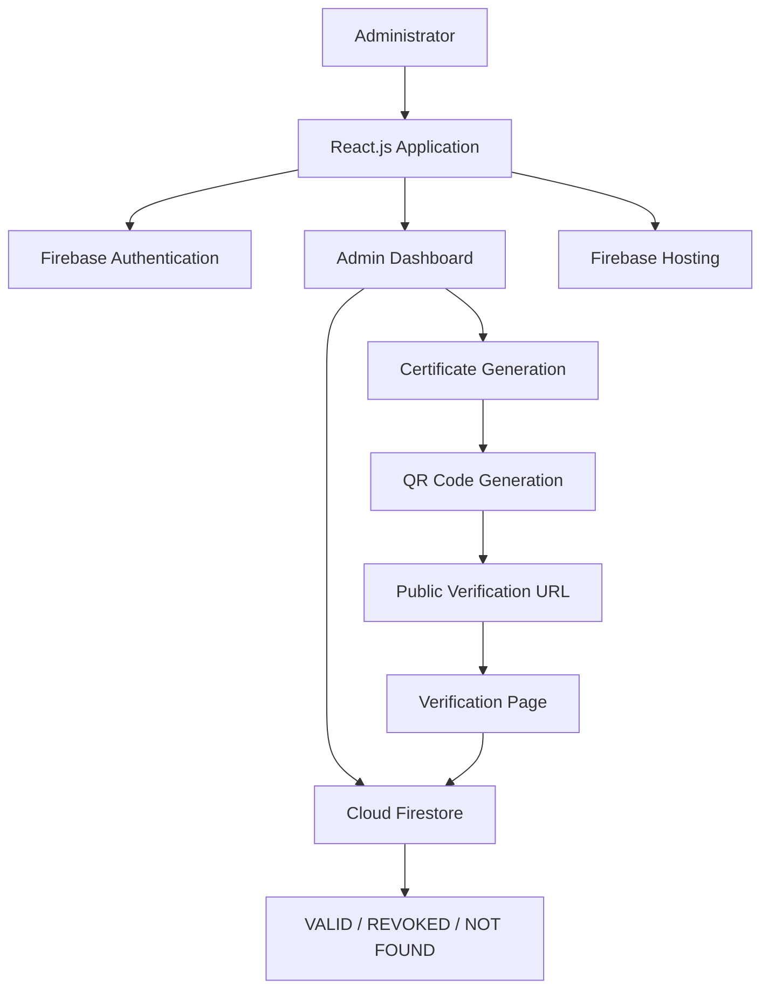

# CertVerify – Digital Certificate Verification System

A cloud-based digital certificate verification platform that enables secure, quick, and reliable certificate authentication using QR codes.

CertVerify allows administrators to register, generate, manage, and revoke digital certificates while enabling anyone to verify certificate authenticity through a public verification link.

**Live Demo:** https://certverify-94a64.web.app

---

## 1. Project Overview

CertVerify is designed to simplify the process of issuing and verifying digital certificates. Traditional paper-based certificates can be difficult to authenticate and vulnerable to forgery.

This system uses QR code technology and Firebase cloud services to provide real-time certificate verification. Each certificate has a unique ID and a QR code that directs users to its online verification page.

The verification process checks the certificate's current status in the Firestore database rather than relying only on the QR code.

## 2. Key Features

### Admin Dashboard
- Secure administrator login using Firebase Authentication.
- Dashboard displaying total, valid, revoked, and monthly generated certificates.
- Monthly certificate generation analytics.
- Valid and revoked certificate distribution chart.
- Recent certificate activity.

### Certificate Management
- Register and generate digital certificates.
- Assign unique certificate IDs.
- Generate QR codes for certificates.
- Search certificates by recipient, course, institution, or certificate ID.
- Filter certificates by status and issue date.
- Revoke certificates when required.

### Certificate Verification
- Public certificate verification without administrator login.
- QR code-based verification.
- Real-time verification using Cloud Firestore.
- Three verification outcomes:
  - VALID
  - REVOKED
  - NOT FOUND

### Reports and Export
- Export certificate records to Excel.
- Generate PDF analytics reports.
- Download individual certificates as PDF files.

## 3. Technology Stack

| Category | Technologies |
|---|---|
| Frontend | React.js, JavaScript |
| Build Tool | Vite |
| Styling | CSS |
| Authentication | Firebase Authentication |
| Database | Cloud Firestore |
| Hosting | Firebase Hosting |
| QR Code | qrcode |
| PDF Generation | jsPDF |
| Excel Export | xlsx |
| Version Control | Git and GitHub |

## 4. System Architecture

The application follows a cloud-based architecture.

1. The administrator accesses the React application.
2. Firebase Authentication manages administrator login.
3. Certificate information is stored in Cloud Firestore.
4. A QR code is generated for each certificate.
5. The QR code opens the public verification page.
6. The verification page retrieves the certificate's current status from Firestore.
7. Firebase Hosting serves the application online.

### Architecture Diagram



## 5. Application Modules

| Module | Description |
|---|---|
| Admin Login | Authenticates authorized administrators |
| Dashboard | Displays certificate statistics and analytics |
| Certificate Registration | Registers new digital certificates |
| Certificate Generation | Generates downloadable PDF certificates |
| QR Code Generation | Creates unique QR codes for verification |
| Public Verification | Checks certificate authenticity |
| Revocation Management | Updates certificate status |
| Reports and Export | Generates PDF reports and Excel exports |

## 6. Project Structure

```text
certificate-verification/
│
├── public/
├── src/
│   ├── components/
│   │   ├── Dashboard.jsx
│   │   ├── RegisterCertificate.jsx
│   │   └── GenerateCertificate.jsx
│   │
│   ├── firebase.js
│   ├── App.jsx
│   └── main.jsx
│
├── .gitignore
├── firebase.json
├── package.json
├── index.html
└── README.md
```

*Note: The structure above highlights the main project files. Other components and configuration files may also be present.*

## 7. Installation and Setup

Follow these steps to run the project locally.

### Prerequisites
- Node.js and npm
- Git
- A Firebase project

### Step 1: Clone the Repository

```bash
git clone https://github.com/aditya-2605/CertVerify-Digital-Certificate-Verification.git
```

### Step 2: Navigate to the Project

```bash
cd CertVerify-Digital-Certificate-Verification
```

### Step 3: Install Dependencies

```bash
npm install
```

### Step 4: Configure Firebase

Create a Firebase project and enable:

- Firebase Authentication
- Cloud Firestore
- Firebase Hosting

Configure the Firebase client settings in `src/firebase.js` using your own Firebase project configuration.

Set up the required Firestore collections and security rules before using the application.

### Step 5: Start the Development Server

```bash
npm run dev
```

Open the local URL displayed in your terminal.

### Step 6: Build for Production

```bash
npm run build
```

## 8. Database Collections

The application uses Cloud Firestore.

| Collection | Purpose |
|---|---|
| admins | Stores authorized administrator records |
| certificates | Stores certificate management records |
| publicCertificates | Stores limited information required for public verification |

The public verification page uses the public certificate record to check the latest certificate status.

## 9. Screenshots

Add screenshots of your application in a folder named `screenshots` in the project root.

Suggested screenshots:

- Admin Login
- Admin Dashboard
- Certificate Registration
- All Certificates
- Certificate PDF
- Public Verification – Valid
- Public Verification – Revoked

Once added, display them here using Markdown image links.

Example:

```markdown

```

## 10. Future Enhancements

- Multiple administrator roles and permissions.
- Bulk certificate generation.
- Email notifications for certificate issuance.
- Certificate verification history and audit logs.
- Advanced analytics and reporting.
- Improved certificate templates and customization.

## 11. Project Benefits

- Reduces manual certificate verification.
- Helps identify forged or revoked certificates.
- Provides quick QR-based authentication.
- Centralizes certificate management.
- Makes certificate verification accessible online.

## 12. Author

**Aditya Patil**

Computer Engineering Student | Full Stack Developer | AI/ML & Cloud Enthusiast

GitHub: https://github.com/aditya-2605

---

## 13. Live Project

**Try CertVerify:** https://certverify-94a64.web.app

---

*CertVerify – Making Digital Certificate Verification Simple, Secure, and Reliable.*


